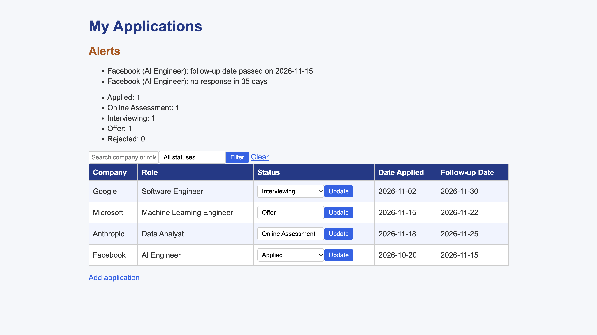

# Internship Tracker

A simple Java web app for tracking internship applications, their stages, and when to follow up.

## The Problem

Applying to internships involves keeping track of many deadlines and follow-ups, and trying to monitor all of it in a spreadsheet gets confusing fast. I often miss deadlines and forget to reply to recruiters because I don't check my spreadsheet often enough. Trackers like Simplify exist, but they're more useful for people applying to full-time roles and often have financial barriers.

## How it Works

Internship Tracker is a Java web app that records internship applications with their company, role, date applied, status, and follow-up date, and saves them to a JSON file. The app has two pages:

- **Dashboard (`/`):** shows every application in a table, how many applications are in each stage, and alerts for applications that need a follow-up. Each row has a dropdown to update its status, and a search box and status filter at the top narrow down the table.
- **Add form (`/add.html`):** a form for entering a new application. After submitting, you're redirected back to the dashboard.

Alerts only apply to applications still in **Applied** or **Online Assessment**. An alert appears when the follow-up date has passed, or when it's been more than 21 days since applying with no change in status.

**Features:**
- Add an application with company, role, date applied, status, and follow-up date
- Save applications to a file and load them when the app starts
- Update an application's status as it moves through stages (Applied, Online Assessment, Interviewing, Offer, Rejected)
- Dashboard showing how many applications are in each stage
- Alerts for applications past their follow-up date or with no response after 21 days
- Search applications by company or role, and filter by status


Design files: [Eisenhower Matrix](Eisenhower%20Matrix.pdf) · [System Diagram source](System%20Diagram.drawio)

## Tech Stack

- **Languages:** Java, HTML, CSS
- **Libraries:** Javalin (web server), Gson (JSON saving/loading), java.time (date calculations for alerts)
- **Data storage:** `applications.json`
- **Tools:** Maven, Git/GitHub, VS Code

## Setup

Requires Java 17+ and Maven.

```bash
git clone https://github.com/rarunach03/internship-tracker
cd internship-tracker
mvn compile exec:java -Dexec.mainClass="Main"
```

Then open `http://localhost:8080` in your browser.

## Usage

1. On the dashboard, click **Add application**.
2. Fill in the form, for example:
   - Company: `Facebook`
   - Role: `AI Engineer`
   - Status: `Applied`
   - Date Applied: `2026-10-20`
   - Follow-up Date: `2026-11-15`
3. Submit. You're redirected to the dashboard, where:
   - the application appears as a new row in the table
   - the **Applied** count goes up by 1
   - two alerts appear: one because the follow-up date has passed, and one because it's been more than 21 days with no response
4. Change the row's status to **Interviewing** and click **Update**. The counts update and both alerts disappear.
5. Type `face` in the search box, or pick a status from the filter, and click **Filter** to narrow the table. Click **Clear** to show everything again.



## Demo

*Video link coming soon.*

## Roadmap

- [x] Add applications with company, role, status, and dates
- [x] Save and load applications from JSON
- [x] Update an application's status
- [x] Show the number of applications in each stage
- [x] Alerts for missed follow-ups and no response
- [x] Search and filter applications
- [x] Basic CSS styling
- [ ] Sort applications
- [ ] Stats page with response rate and applications per week
- [ ] Notes and recruiter contact fields
- [ ] Separate tracking for application deadlines

## Author

Rahul Arunachalam — [github.com/rarunach03](https://github.com/rarunach03)
